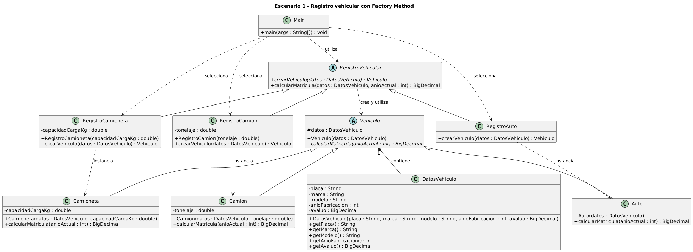
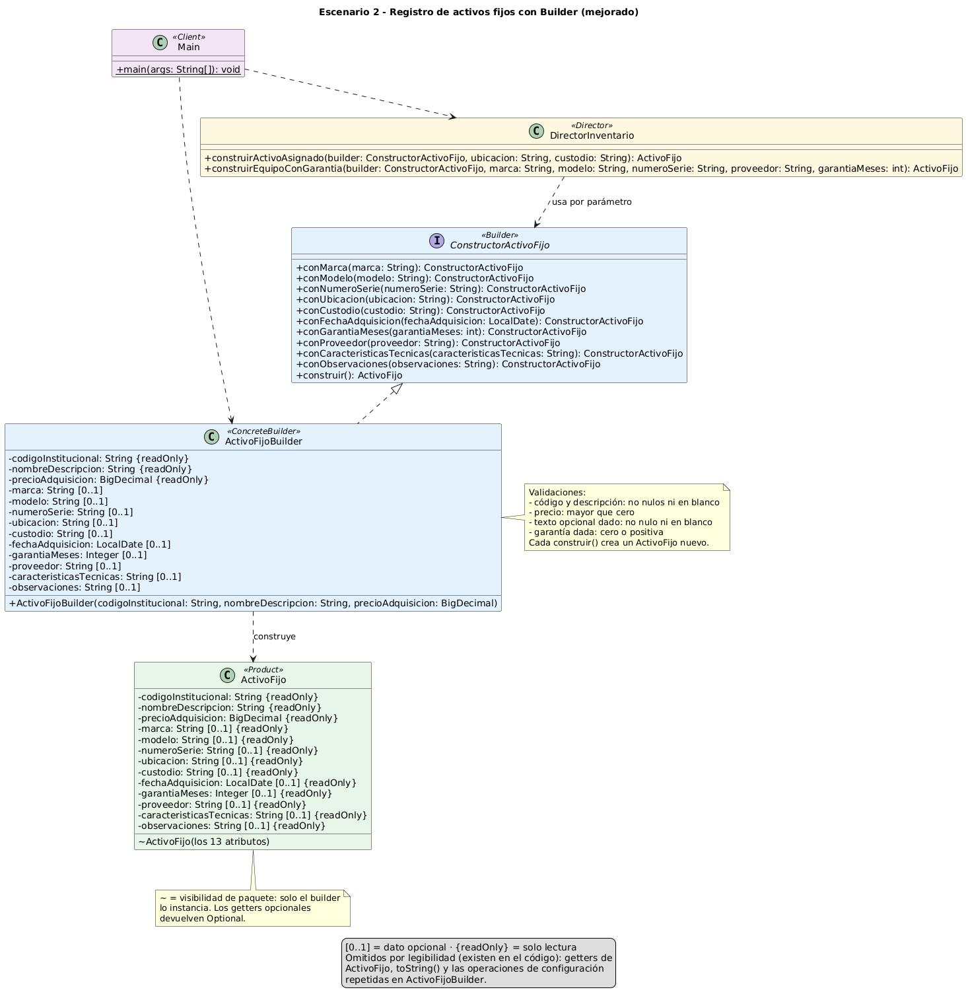

# Actividad 01 - Patrones creacionales

**UNIVERSIDAD POLITÉCNICA SALESIANA - ECUADOR · Posgrados | Maestría en Software**

## Datos generales de la actividad

| | |
|---|---|
| **Asignatura** | Patrones de Diseño de Software |
| **Actividad de aprendizaje #** | 01 - Patrones creacionales |
| **Docente** | Mauricio Ortiz Ochoa |
| **Fecha** | 2026/10/15 |
| **Grupo base** | Grupo 01 |
| **Resultado de aprendizaje** | RA1. Selecciona y aplica patrones creacionales para resolver problemas de creación de objetos, revisando críticamente las alternativas elaboradas con apoyo de inteligencia artificial. |

### Integrantes

| N.º | Integrante (Apellidos Nombres) |
|---|---|
| 1 | Aliatis Ramirez Enzo Paolo |
| 2 | Cadme Vázquez Mauro Emiliano |
| 3 | Murillo Valarezo Jordan Fernando |
| 4 | Suárez Pesantez Galo Fabian |

### Entregables

- Archivo en PDF con el nombre `PDS_Actividad_01_GrupoXX.pdf`.
- Aplicación de software almacenada en un repositorio de código (este repositorio).
- La actividad se desarrolla en grupo; la carga al AVAC es individual.

### Tareas específicas

1. Participar en la clase de la Unidad 01, secciones 01, 02 y 03.
2. Leer detenidamente el material de apoyo relacionado.
3. Crear un repositorio de código para almacenar la aplicación solicitada.
4. Seguir las instrucciones del ejercicio.

### Requerimientos generales para ambos escenarios

Para cada escenario, el grupo debe:

1. Identificar el problema de creación de objetos.
2. Seleccionar y justificar el patrón creacional correspondiente.
3. Elaborar el diagrama de clases UML.
4. Identificar los participantes del patrón.
5. Implementar la solución en un lenguaje de programación.
6. Almacenar el código en el repositorio del grupo.
7. Documentar el uso crítico de IA: prompt principal, una recomendación aceptada, una recomendación modificada o rechazada, y la justificación de ambas decisiones.

Además, el informe incluye unas conclusiones de la actividad (200 palabras), que están en la sección [Conclusiones de la actividad](#conclusiones-de-la-actividad) de este archivo.

### Rúbrica de evaluación

Cada criterio se califica de 0 (no presenta) a 3 (nivel alto):

- Selección, justificación y diagrama UML de Factory Method.
- Implementación funcional y correspondencia UML-código de Factory Method.
- Selección, justificación y diagrama UML de Builder.
- Implementación funcional y correspondencia UML-código de Builder.
- Uso crítico de IA, justificación y conclusiones.

Material de apoyo: `Unidad_01_01_PDS.pdf`, `Unidad_01_02_PDS.pdf` y `Unidad_01_03_PDS.pdf`.

## Escenarios

| Escenario | Problema | Patrón | Estado | Documentación |
|---|---|---|---|---|
| 1. Registro vehicular | Crear el tipo de vehículo (Auto, Camioneta, Camión) elegido en tiempo de ejecución y calcular su matrícula sin depender de clases concretas | Factory Method | Documentado | [`escenario-1-registro-vehicular`](escenario-1-registro-vehicular/README.md) |
| 2. Activos fijos | Construir paso a paso activos con datos obligatorios y opcionales | Builder | Documentado | [`escenario-2-registro-activos`](escenario-2-registro-activos/README.md) |

## Escenario 1: Registro vehicular con Factory Method

### Enunciado

Una empresa desarrolla una aplicación para registrar vehículos y calcular el valor correspondiente a su matrícula. Actualmente el sistema debe trabajar con tres tipos de vehículos: **Auto**, **Camioneta** y **Camión**. Todos comparten información general, como placa, marca, modelo, año de fabricación y avalúo, y todos deben ofrecer una operación para obtener el costo de matrícula.

Sin embargo, el cálculo no es igual para todos los tipos de vehículo. Por ejemplo, un Auto puede considerar principalmente su avalúo y antigüedad; una Camioneta puede incorporar además características relacionadas con su capacidad o uso; y un Camión puede requerir información adicional como tonelaje o capacidad de carga. Cada tipo de vehículo debe, por tanto, implementar su propia lógica de cálculo manteniendo un contrato común.

La aplicación no conoce de antemano qué tipo concreto de vehículo deberá utilizar. La selección será realizada durante la ejecución del sistema a partir de la información proporcionada por el cliente. Una vez seleccionado el tipo, el resto del proceso debería poder trabajar con el vehículo sin depender directamente de Auto, Camioneta o Camión.

Además, la empresa prevé incorporar posteriormente otros tipos de vehículos, por ejemplo motocicletas, buses o vehículos eléctricos. Se desea que la incorporación de estas nuevas variantes no obligue a modificar continuamente la lógica principal que utiliza los vehículos ni a distribuir instrucciones de creación de clases concretas por diferentes partes de la aplicación.

**Tarea:** diseñar una solución orientada a objetos que permita delegar adecuadamente la creación del vehículo requerido, mantener un tratamiento común de los distintos tipos y facilitar la incorporación futura de nuevas variantes.

### El problema de creación de objetos

- El tipo concreto de vehículo se conoce solo en ejecución.
- El resto del proceso no debe depender de `Auto`, `Camioneta` ni `Camion`.
- Cada tipo calcula la matrícula con su propia lógica, bajo un contrato común.
- Deben poder agregarse tipos nuevos sin modificar la lógica principal ni dispersar la creación de clases concretas.

### La solución

Se aplica **Factory Method**: la creación del vehículo se delega a un creador concreto y el resto del
proceso trabaja solo con las abstracciones.

| Rol del patrón | Clases |
|---|---|
| Product | `Vehiculo` (abstracta, con `calcularMatricula`) |
| ConcreteProduct | `Auto`, `Camioneta`, `Camion` |
| Creator | `RegistroVehicular` (declara el factory method `crearVehiculo`) |
| ConcreteCreator | `RegistroAuto`, `RegistroCamioneta`, `RegistroCamion` |
| Cliente | `Main`, el único lugar que elige el creador según el tipo pedido |

Los datos comunes (placa, marca, modelo, año de fabricación y avalúo) se agrupan en `DatosVehiculo`,
inmutable y compuesto dentro de cada `Vehiculo`. Agregar un tipo nuevo exige una subclase de
`Vehiculo`, su creador y una opción en `Main`; las clases existentes no cambian.

La justificación completa, el análisis del diseño y el uso crítico de IA están en el
[informe del escenario 1](escenario-1-registro-vehicular/README.md).

### Qué contiene

| Carpeta | Contenido |
|---|---|
| [`escenario-1-registro-vehicular/uml`](escenario-1-registro-vehicular/uml) | Diagramas de clases en PlantUML (original y mejorado) y sus imágenes |
| [`escenario-1-registro-vehicular/codigo`](escenario-1-registro-vehicular/codigo) | Proyecto Maven (Java 21) con la implementación y las pruebas, y su [manual de uso](escenario-1-registro-vehicular/codigo/README.md) |
| [`escenario-1-registro-vehicular/docs`](escenario-1-registro-vehicular/docs) | [Trazabilidad UML-código](escenario-1-registro-vehicular/docs/trazabilidad-uml-codigo.md) |

### Diagrama de clases (versión final)



### Probarlo rápidamente

Desde `escenario-1-registro-vehicular/codigo`, solo con el JDK 21:

```text
mkdir -p target/classes
javac -encoding UTF-8 -d target/classes $(find src/main -name '*.java')
java -cp target/classes ec.edu.ups.pds.factorymethod.Main camioneta ABC-1234 Toyota Hilux 2020 20000 1000 2026
```

Salida: `Tipo: camioneta | Placa: ABC-1234 | Matricula: $397.20`. Las instrucciones completas están en el
[manual de uso](escenario-1-registro-vehicular/codigo/README.md).

### Verificación UML contra código

La prueba `CorrespondenciaUmlCodigoTest` comprueba el código contra el diagrama mejorado: clases,
jerarquías, atributos, visibilidad, constructores, operaciones, los getters de `DatosVehiculo`, la
ausencia de setters y la composición `contiene`. En la última ejecución, las 14 pruebas del escenario
pasaron sin fallos.

> **Maven:** los `pom.xml` de los escenarios declaran un POM padre (`../../pom.xml` en ambos escenarios) que **aún no existe** en el repositorio, así que `mvn` no arranca tal como
> está. Las pruebas se ejecutaron con una copia temporal del módulo y un `pom.xml` independiente.
> Hasta crear el POM padre, los escenarios se compilan y ejecuta con el JDK como se indica arriba.

## Escenario 2: Activos fijos con Builder

### Enunciado

Una institución necesita desarrollar un módulo para registrar sus activos fijos, entre los que pueden existir computadores, monitores, impresoras, muebles, vehículos y otros bienes institucionales.

Todo activo fijo debe registrar obligatoriamente al menos:

- código institucional;
- nombre o descripción;
- precio de adquisición.

Dependiendo del tipo de activo y de la información disponible, también pueden registrarse datos opcionales como: marca, modelo, número de serie, ubicación, custodio responsable, fecha de adquisición, período de garantía, proveedor, características técnicas y observaciones.

No todos los activos poseen todos estos datos. Por ejemplo, un computador puede requerir marca, modelo, número de serie, procesador y garantía, mientras que una mesa puede necesitar únicamente material, dimensiones, ubicación y custodio.

Si se intenta resolver el problema mediante constructores tradicionales, podrían aparecer múltiples constructores con diferentes cantidades y combinaciones de parámetros. Además, una llamada como:

```java
new ActivoFijo("AF001", "Computador", 1200, "Dell", "Latitude", null, "Cuenca", true, 36, ...)
```

sería difícil de leer, mantener y utilizar correctamente, especialmente cuando aumenta el número de atributos opcionales.

La institución necesita que los objetos puedan construirse progresivamente, estableciendo primero la información obligatoria y agregando posteriormente únicamente las características que correspondan a cada activo. La solución debe hacer explícito qué información se está incorporando y permitir obtener finalmente un objeto correctamente configurado.

También debe ser posible crear diferentes configuraciones sin tener que mantener una gran cantidad de constructores sobrecargados ni obligar a proporcionar valores vacíos para características que no aplican.

**Tarea:** diseñar una solución orientada a objetos que permita construir activos fijos paso a paso, manejar adecuadamente atributos obligatorios y opcionales y mantener legible el proceso de creación.

### El problema de creación de objetos

- Tres datos son obligatorios y diez opcionales, y cada activo usa una combinación distinta.
- Los constructores tradicionales producirían muchas sobrecargas y llamadas ilegibles con `null`.
- El objeto debe construirse paso a paso, haciendo explícito qué dato se incorpora.
- El resultado debe ser un objeto correctamente configurado.

### La solución

Se aplica **Builder** con métodos fluidos: se inicia con los datos obligatorios y se agregan solo los
opcionales pertinentes.

| Rol del patrón | Clases |
|---|---|
| Product | `ActivoFijo` (inmutable) |
| Builder | `ConstructorActivoFijo` (interfaz con los pasos fluidos y `construir`) |
| ConcreteBuilder | `ActivoFijoBuilder` (exige los obligatorios, valida y crea el producto) |
| Director | `DirectorInventario` (dos secuencias de construcción reutilizables) |
| Cliente | `Main` |

Todos los bienes comparten el mismo producto; no hay una jerarquía por tipo de activo. La justificación
completa, los diagramas y el uso crítico de IA están en el
[informe del escenario 2](escenario-2-registro-activos/README.md). Las conclusiones de ambos escenarios
están en [Conclusiones de la actividad](#conclusiones-de-la-actividad).

### Qué contiene

| Carpeta | Contenido |
|---|---|
| [`escenario-2-registro-activos/uml`](escenario-2-registro-activos/uml) | Diagramas de clases en PlantUML (original y mejorado) y sus imágenes |
| [`escenario-2-registro-activos/codigo`](escenario-2-registro-activos/codigo) | Proyecto Maven (Java 21) con la implementación y las pruebas, y su [manual de uso](escenario-2-registro-activos/codigo/README.md) |
| [`escenario-2-registro-activos/docs`](escenario-2-registro-activos/docs) | [Trazabilidad UML-código](escenario-2-registro-activos/docs/trazabilidad-uml-codigo.md) |

### Diagrama de clases (versión final)



### Probarlo rápidamente

Desde `escenario-2-registro-activos/codigo`, solo con el JDK 21:

```text
mkdir -p target/classes
javac -encoding UTF-8 -d target/classes $(find src/main -name '*.java')
java -cp target/classes ec.edu.ups.pds.builder.Main
```

### Verificación UML contra código

La prueba `CorrespondenciaUmlCodigoTest` comprueba el código contra el diagrama mejorado:
participantes, relaciones, campos, modificadores, constructor obligatorio, firmas y la visibilidad de
paquete del constructor de `ActivoFijo`. En la última ejecución, las 14 pruebas del escenario pasaron
sin fallos.

## Conclusiones de la actividad

Factory Method encajó en el escenario 1 porque el tipo de vehículo solo se conoce en ejecución. Los creadores concretos instancian cada vehículo y la operación principal usa únicamente `RegistroVehicular` y `Vehiculo`, así que agregar una motocicleta pide una subclase, su creador y una opción en `Main`, sin modificar lo demás. En el escenario 2, Builder nos permitió armar activos fijos paso a paso: se parte de los tres datos obligatorios y se suman solo los opcionales que apliquen, sin sobrecargas ni valores vacíos. El producto es inmutable y el Director reúne dos secuencias que se repiten.

En ambos escenarios una prueba compara el código con el diagrama mejorado, y las 14 pruebas de cada uno pasan. Las ejecutamos sin Maven porque falta el POM padre en el repositorio.

Usamos la IA para revisar los diseños y contrastamos cada recomendación con el UML y el código. En el escenario 1 incorporamos el constructor y las consultas de `DatosVehiculo` y rechazamos Strategy, porque el cálculo depende solo del tipo de vehículo. En el escenario 2 mantuvimos y documentamos las validaciones que ya existían, y descartamos eliminar el Director y la interfaz, porque ya hay dos secuencias reutilizables.

## Estructura del repositorio

```text
.
├── README.md                              Este archivo
├── escenario-1-registro-vehicular/
│   ├── README.md                          Informe del escenario 1
│   ├── uml/                               Diagramas PlantUML e imágenes
│   ├── codigo/                            Proyecto Maven y manual de uso
│   └── docs/                              Trazabilidad UML-código
└── escenario-2-registro-activos/
    ├── README.md                          Informe del escenario 2
    ├── uml/                               Diagrama PlantUML
    ├── codigo/                            Proyecto Maven y manual de uso
    └── docs/                              Trazabilidad UML-código
```
