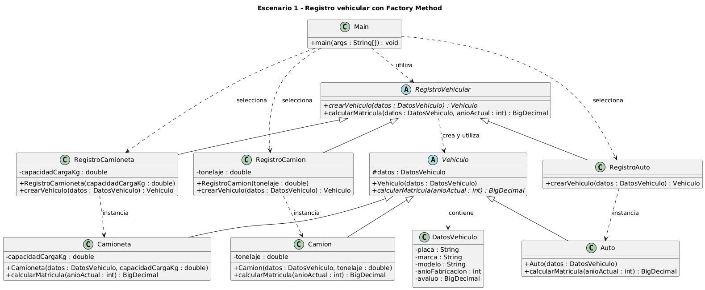

# Escenario 1 - Registro vehicular con Factory Method

Proyecto Maven con Java 21 para el escenario 1 de la actividad de patrones creacionales. La
creacion de cada vehiculo se delega a un creador concreto; la operacion principal depende de los
contratos `RegistroVehicular` y `Vehiculo`, no de una clase concreta.

## Estructura del escenario

El escenario separa el diseño UML del código fuente en carpetas distintas:

```text
escenario-1-registro-vehicular/
├── README.md                          Informe del escenario (este archivo)
├── uml/                               Diseño: diagramas de clases
│   ├── factoryMethodE1.puml           Fuente PlantUML original
│   ├── factoryMethodE1_mejorado.puml  Fuente PlantUML mejorada (versión final)
│   ├── diagrama-clases-original.png   Imagen del diagrama original
│   └── diagrama-clases-mejorado.png   Imagen del diagrama mejorado
├── codigo/                            Implementación: proyecto Maven (Java 21)
│   ├── pom.xml
│   └── src/
│       ├── main/java/ec/edu/ups/pds/factorymethod/   Clases del patrón y Main
│       └── test/java/ec/edu/ups/pds/factorymethod/   Pruebas
└── docs/
    └── trazabilidad-uml-codigo.md     Correspondencia entre el UML y el código
```

- `uml/` no depende de Maven: los diagramas se editan y renderizan con PlantUML.
- `codigo/` es el módulo Maven; todos los comandos de compilación y ejecución se lanzan desde esa carpeta.
- La prueba `CorrespondenciaUmlCodigoTest` une ambas carpetas: lee `../uml/factoryMethodE1_mejorado.puml` y lo compara con las clases Java.

## Contenido

1. [El problema de creación de objetos](#el-problema-de-creación-de-objetos)
2. [Justificación](#justificación)
3. [Diagrama de clases](#diagrama-de-clases)
4. [Código fuente](#código-fuente)
5. [Uso crítico de inteligencia artificial](#uso-crítico-de-inteligencia-artificial)

## El problema de creación de objetos

- El tipo concreto de vehículo (auto, camioneta o camión) se conoce solo en ejecución, según los datos que entrega el cliente.
- El resto del proceso no debe depender de `Auto`, `Camioneta` ni `Camion`.
- Cada tipo calcula la matrícula con su propia lógica, pero todos comparten un contrato común.
- La empresa agregará tipos nuevos (motocicletas, buses, eléctricos) y eso no debe obligar a modificar la lógica principal ni a repartir la creación de clases concretas por la aplicación.

## Justificación

Elegimos Factory Method porque la aplicación no sabe qué tipo de vehículo va a necesitar hasta que el cliente entrega sus datos, y la empresa planea agregar más tipos sin modificar la lógica principal.

Vehiculo es una clase abstracta con el contrato común. Declara calcularMatricula como abstracta para que Auto, Camioneta y Camion implementen cada una su propia regla. Usamos una clase abstracta y no una interfaz porque los tres tipos comparten la información general, agrupada en DatosVehiculo para evitar constructores con muchos parámetros. Los datos propios de cada tipo, como la capacidad de carga de la camioneta o el tonelaje del camión, se quedan en su subclase.

RegistroVehicular declara el método abstracto crearVehiculo, y RegistroAuto, RegistroCamioneta y RegistroCamion lo redefinen para instanciar su vehículo. Su operación calcularMatricula obtiene el vehículo y lo usa solo a través de Vehiculo, sin depender de clases concretas. Los datos específicos llegan por el constructor de cada creador, así que crearVehiculo tiene la misma firma en todos.

El año actual se recibe como parámetro para que el cálculo sea fácil de probar, y los montos usan BigDecimal para evitar errores de redondeo. La elección del creador ocurre solo en Main. Para agregar una motocicleta basta con crear su subclase de Vehiculo, su creador y la opción en Main, sin cambiar las clases existentes.

### Participantes del patrón

| Rol del patrón | Clase | Responsabilidad |
|---|---|---|
| Product | `Vehiculo` | Clase abstracta con el contrato común y `calcularMatricula` abstracto. |
| ConcreteProduct | `Auto`, `Camioneta`, `Camion` | Cada una implementa su propia regla de cálculo. |
| Creator | `RegistroVehicular` | Declara el factory method `crearVehiculo` y la operación `calcularMatricula`, que trabaja solo con `Vehiculo`. |
| ConcreteCreator | `RegistroAuto`, `RegistroCamioneta`, `RegistroCamion` | Redefinen `crearVehiculo` para instanciar su vehículo. |
| Client | `Main` | Único lugar que elige el creador según el tipo pedido. |

`DatosVehiculo` no es un rol del patrón. Agrupa los datos comunes para que todos los creadores reciban el mismo argumento.

### Análisis del diseño de registro vehicular con Factory Method

#### 1. Aplicación del patrón

La solución aplica correctamente Factory Method. Vehiculo cumple el papel de Product, y Auto, Camioneta y Camion son los productos concretos. RegistroVehicular es el Creator, porque declara el método crearVehiculo, y RegistroAuto, RegistroCamioneta y RegistroCamion son los creadores concretos.

La operación calcularMatricula de RegistroVehicular trabaja con el vehículo a través de la abstracción Vehiculo y no conoce ninguna clase concreta, que es lo que pide el enunciado. Para incorporar una motocicleta basta con agregar una nueva subclase de Vehiculo y su creador correspondiente, sin modificar la lógica que usa los vehículos. Esto respeta el principio abierto/cerrado.

#### 2. Clases, relaciones y responsabilidades

En general están bien definidas, pero hay tres puntos por revisar.

DatosVehiculo tiene todos sus atributos privados y no declara constructor ni operaciones de consulta. Las subclases de Vehiculo necesitan el avalúo y el año de fabricación para calcular la matrícula, y el diagrama no muestra cómo los obtienen.

La relación entre Vehiculo y DatosVehiculo no tiene multiplicidades, que son obligatorias en el diagrama de clases. También falta decidir si se trata de una asociación simple o de una composición. Si DatosVehiculo solo existe como parte del vehículo, la composición representa mejor la dependencia de ciclo de vida.

El nombre calcularMatricula se usa tanto en el Creator como en el Product, lo que dificulta leer el diagrama. Un nombre como registrarMatricula o procesarMatricula distinguiría la operación del Creator del cálculo que hace cada vehículo.

#### 3. Decisiones acertadas

Agrupar la información común en DatosVehiculo evita constructores con muchos parámetros y permite que todos los creadores reciban el mismo argumento en crearVehiculo. Los datos propios de cada tipo, como la capacidad de carga o el tonelaje, se pasan al constructor del creador concreto, de modo que la firma abstracta de crearVehiculo no cambia.

Recibir el año actual como parámetro, en lugar de leerlo del reloj del sistema, quita una dependencia oculta y hace que el cálculo dé siempre el mismo resultado ante los mismos datos, lo que facilita las pruebas. Usar BigDecimal para los montos evita los errores de redondeo de double. Que Vehiculo sea una clase abstracta y no una interfaz está justificado porque todos los tipos comparten el atributo datos además del contrato. Por último, las dependencias tienen etiquetas como "instancia" o "crea y utiliza", que dejan claro quién crea cada objeto.

#### 4. Mejoras recomendadas

La primera mejora es completar DatosVehiculo con su constructor y sus consultas, y evaluar si el atributo datos de Vehiculo debería ser privado con acceso controlado en lugar de protegido.

La segunda es agregar las multiplicidades y precisar el tipo de relación entre Vehiculo y DatosVehiculo.

La tercera es dejar documentado que RegistroCamioneta y RegistroCamion son de un solo uso. Como guardan datos de un vehículo concreto, cada registro necesita una instancia nueva del creador. Es un compromiso aceptable si queda explícito, para que nadie intente reutilizarlos ni compartirlos.

La cuarta tiene que ver con Main, que depende de los tres creadores concretos. Alguna parte del sistema tiene que elegir el tipo según la información del cliente, así que esa dependencia es inevitable. Conviene indicar en el diagrama que Main es el único lugar que cambia al agregar un tipo nuevo, para cumplir con la condición de no dispersar la creación de clases concretas por la aplicación.

#### 5. Alternativas

Strategy podría considerarse más adelante para el cálculo de la matrícula, si las reglas llegaran a variar con independencia del tipo de vehículo, por ejemplo por cambios normativos o por año fiscal. Con el enunciado actual el cálculo depende solo del tipo, y agregarlo ahora sería sobrediseño.

Las demás alternativas no aportan beneficios. Abstract Factory no aplica porque no hay familias de productos relacionados. Builder tampoco, porque DatosVehiculo tiene cinco campos obligatorios y su construcción no tiene pasos ni representaciones distintas. Convertir los creadores en Singleton sería un error, ya que RegistroCamioneta y RegistroCamion guardan datos de un vehículo específico y compartirlos generaría inconsistencias. Una fábrica simple con switch volvería a centralizar el condicional que Factory Method busca eliminar; a lo sumo serviría para traducir la entrada del usuario al creador que corresponde. Prototype o un registro de creadores por reflexión añadirían complejidad sin responder a ninguna necesidad del problema.

En resumen, el diseño aplica Factory Method de forma correcta y proporcionada. Las mejoras propuestas corrigen detalles del modelo, como la encapsulación de DatosVehiculo, las multiplicidades y los nombres, y no exigen cambiar la arquitectura.

## Diagrama de clases

### Diagrama original

Versión previa a la mejora sugerida con IA. Fuente: [`uml/factoryMethodE1.puml`](uml/factoryMethodE1.puml).



### Diagrama mejorado

Versión final, con constructor y consultas en `DatosVehiculo` y composición 1 a 1 con `Vehiculo`. Fuente: [`uml/factoryMethodE1_mejorado.puml`](uml/factoryMethodE1_mejorado.puml).


## Código fuente

- Código: [`codigo/src/main/java/ec/edu/ups/pds/factorymethod`](codigo/src/main/java/ec/edu/ups/pds/factorymethod)
- Pruebas: [`codigo/src/test/java/ec/edu/ups/pds/factorymethod`](codigo/src/test/java/ec/edu/ups/pds/factorymethod)
- Manual de uso (requisitos, compilación, ejecución, argumentos, reglas de cálculo, pruebas y cómo agregar un tipo de vehículo): [`codigo/README.md`](codigo/README.md)
- Trazabilidad entre el UML y el código: [`docs/trazabilidad-uml-codigo.md`](docs/trazabilidad-uml-codigo.md)

Inicio rápido, desde `escenario-1-registro-vehicular/codigo`:

```text
mkdir -p target/classes
javac -encoding UTF-8 -d target/classes $(find src/main -name '*.java')
java -cp target/classes ec.edu.ups.pds.factorymethod.Main auto ABC-1234 Toyota Corolla 2020 20000 0 2026
```

Salida esperada: `Tipo: auto | Placa: ABC-1234 | Matricula: $352.00`.

### Verificación UML contra código

`CorrespondenciaUmlCodigoTest` comprueba el código contra el diagrama mejorado
(`uml/factoryMethodE1_mejorado.puml`). Última ejecución: 28 pruebas, 0 fallos.

## Uso crítico de inteligencia artificial

### Prompt principal

Actúa como un arquitecto de software experto en patrones de diseño GoF, UML y PlantUML.

Adjunto el archivo PlantUML de mi solución al Escenario 1 (registro vehicular con Factory Method). Necesito que apliques únicamente la siguiente mejora, sin rediseñar la solución:

1. En la clase DatosVehiculo, agrega un constructor público que reciba placa (String), marca (String), modelo (String), anioFabricacion (int) y avaluo (BigDecimal).
2. En DatosVehiculo, agrega una operación pública de consulta por cada atributo: getPlaca(), getMarca(), getModelo(), getAnioFabricacion() y getAvaluo(), con sus tipos de retorno. No agregues operaciones de modificación (setters), porque los datos no deben cambiar después del registro.
3. Reemplaza la asociación "Vehiculo --> DatosVehiculo : contiene" por una composición con el rombo del lado de Vehiculo y multiplicidad "1" en ambos extremos, conservando la etiqueta "contiene".

Condiciones:
- No modifiques ninguna otra clase, atributo, método ni relación.
- Mantén el título, la dirección del diagrama y el skinparam existentes.
- Conserva la jerarquía de Vehiculo, la jerarquía de RegistroVehicular, el método crearVehiculo y las dependencias de Main tal como están.
- No generes código Java.

Entrega el archivo PlantUML completo con los cambios aplicados y, al final, una lista breve de las líneas que modificaste.

### Recomendación aceptada

Completar la clase DatosVehiculo con un constructor que reciba placa, marca, modelo, año de fabricación y avalúo, y con una operación de consulta para cada atributo, sin operaciones de modificación. También modelar su relación con Vehiculo como una composición con multiplicidad uno a uno.

La aceptamos porque en el diseño original los atributos de DatosVehiculo eran privados y no había ninguna forma de leerlos, así que Auto, Camioneta y Camion no podían obtener el avalúo ni el año de fabricación para calcular la matrícula. Agregamos solo consultas para que los datos no cambien después del registro y el objeto se mantenga en un estado válido. Elegimos la composición porque DatosVehiculo no tiene sentido fuera del vehículo al que describe, y la multiplicidad uno a uno refleja que cada vehículo tiene exactamente un conjunto de datos generales.

### Recomendación modificada o rechazada

Incorporar el patrón Strategy para separar el cálculo de la matrícula de la jerarquía de vehículos.

La rechazamos porque, según el enunciado, el cálculo depende únicamente del tipo de vehículo, y esa variación ya la resuelve el método abstracto calcularMatricula de Vehiculo mediante polimorfismo. Con Strategy tendríamos que crear una interfaz y una clase de cálculo por cada tipo, duplicando una jerarquía que ya existe. Solo tendría sentido si las reglas de cálculo cambiaran por razones ajenas al tipo de vehículo, como la normativa o el año fiscal, y ese escenario no forma parte del problema actual.
