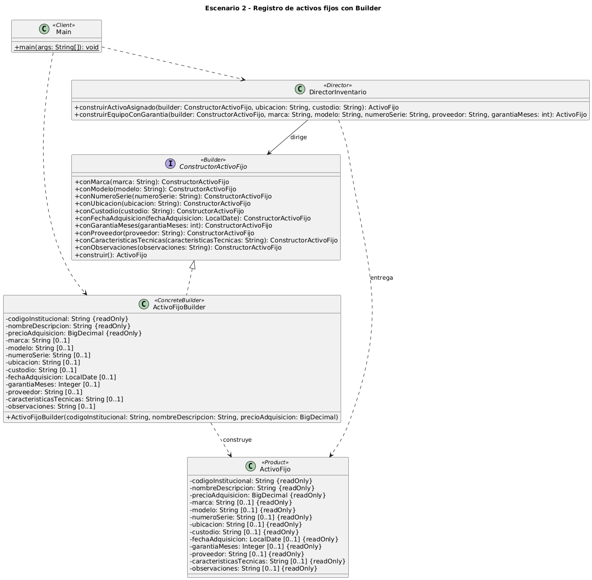

# Escenario 2 - Registro de activos fijos con Builder

Proyecto Maven con Java 21 para el escenario 2 de la actividad de patrones creacionales. El activo
fijo se construye progresivamente, con tres datos obligatorios y diez opcionales, sin recurrir a un
constructor extenso ni a múltiples sobrecargas.

## Estructura del escenario

El escenario separa el diseño UML del código fuente en carpetas distintas:

```text
escenario-2-registro-activos/
├── README.md                          Informe del escenario (este archivo)
├── uml/                               Diseño: diagramas de clases
│   ├── builderE2.puml                 Fuente PlantUML original
│   ├── builderE2_mejorado.puml        Fuente PlantUML mejorada (versión final)
│   ├── diagrama-clases-original.png   Imagen del diagrama original
│   └── diagrama-clases-mejorado.png   Imagen del diagrama mejorado
├── codigo/                            Implementación: proyecto Maven (Java 21)
│   ├── README.md                      Manual de uso
│   ├── pom.xml
│   └── src/
│       ├── main/java/ec/edu/ups/pds/builder/   Clases del patrón y Main
│       └── test/java/ec/edu/ups/pds/builder/   Pruebas
└── docs/
    └── trazabilidad-uml-codigo.md     Correspondencia entre el UML y el código
```

- `uml/` no depende de Maven: los diagramas se editan y renderizan con PlantUML.
- `codigo/` es el módulo Maven; todos los comandos de compilación y ejecución se lanzan desde esa carpeta.
- La prueba `CorrespondenciaUmlCodigoTest` une ambas carpetas: lee `../uml/builderE2_mejorado.puml` y lo compara con las clases Java.

## Contenido

1. [El problema de creación de objetos](#el-problema-de-creación-de-objetos)
2. [Justificación](#justificación)
3. [Diagrama de clases](#diagrama-de-clases)
4. [Código fuente](#código-fuente)
5. [Uso crítico de inteligencia artificial](#uso-crítico-de-inteligencia-artificial)

## El problema de creación de objetos

- Un activo fijo tiene tres datos obligatorios (código institucional, nombre o descripción y precio de adquisición) y diez opcionales, y cada bien usa una combinación distinta.
- Con constructores tradicionales habría muchas sobrecargas, y las llamadas quedarían llenas de `null` para los datos que no aplican.
- El objeto debe construirse paso a paso, dejando claro qué dato se incorpora en cada paso.
- Al terminar, el objeto tiene que quedar correctamente configurado.

## Justificación

Elegimos Builder porque un activo fijo combina tres datos obligatorios con muchos atributos opcionales. Con constructores tradicionales habría que mantener varias sobrecargas o escribir llamadas largas con valores vacíos para las características que no aplican.

`ActivoFijoBuilder` exige el código institucional, el nombre o descripción y el precio de adquisición al iniciar la construcción. Después, los métodos `conMarca`, `conUbicacion` y los demás pasos fluidos agregan solo los datos disponibles, y `construir` devuelve un `ActivoFijo` inmutable. Así la creación de computadores, muebles y otros bienes sigue siendo legible aunque cada uno tenga una configuración distinta.

La construcción queda separada del producto, lo que favorece el principio de responsabilidad única. `DirectorInventario` ejecuta las secuencias frecuentes a través de la interfaz `ConstructorActivoFijo`, de acuerdo con el principio de inversión de dependencias. Basta un solo builder porque todos los bienes comparten la misma estructura de datos y ninguno tiene comportamiento especializado en este escenario.

La implementación valida los datos al recibirlos: los textos obligatorios no pueden estar vacíos, el precio debe ser mayor que cero y la garantía no puede ser negativa. Que el precio sea estrictamente positivo es una decisión nuestra, porque el enunciado solo pide registrarlo. Para omitir un atributo opcional basta con no llamar a su método de configuración.

### Participantes del patrón

| Participante | Clase o interfaz | Responsabilidad |
|---|---|---|
| Builder | `ConstructorActivoFijo` | Define los pasos fluidos y `construir`. |
| ConcreteBuilder | `ActivoFijoBuilder` | Valida y conserva los datos de construcción. |
| Product | `ActivoFijo` | Representa el activo terminado e inmutable. |
| Director | `DirectorInventario` | Agrupa secuencias frecuentes de configuración. |
| Client | `Main` | Configura el builder y solicita el activo. |

Todos los bienes se representan con el mismo producto. Material, dimensiones o procesador se pueden
describir en `caracteristicasTecnicas`, que por ahora es texto libre y no una estructura tipada.

## Diagrama de clases

### Diagrama original

Versión previa a la mejora sugerida con IA. Fuente: [`uml/builderE2.puml`](uml/builderE2.puml).



### Diagrama mejorado

Versión final, con los mismos cinco participantes. Fuente: [`uml/builderE2_mejorado.puml`](uml/builderE2_mejorado.puml). Cambios respecto al original:

- `DirectorInventario` pasa de una asociación a una dependencia «usa por parámetro», porque el Director no guarda un builder como atributo: lo recibe en cada método.
- Se distinguen los datos obligatorios (`{readOnly}`) de los opcionales (`[0..1]`).
- Se muestra el constructor de `ActivoFijo` con visibilidad de paquete (`~`), de modo que solo el builder lo instancia.
- Se añade una nota con las validaciones del builder.
- Se omiten, indicándolo en la leyenda, los getters, `toString()` y las operaciones de configuración repetidas en el builder concreto. Siguen existiendo en el código.


## Código fuente

- Código: [`codigo/src/main/java/ec/edu/ups/pds/builder`](codigo/src/main/java/ec/edu/ups/pds/builder)
- Pruebas: [`codigo/src/test/java/ec/edu/ups/pds/builder`](codigo/src/test/java/ec/edu/ups/pds/builder)
- Manual de uso (requisitos, compilación, ejecución, reglas y pruebas): [`codigo/README.md`](codigo/README.md)
- Trazabilidad entre el UML y el código: [`docs/trazabilidad-uml-codigo.md`](docs/trazabilidad-uml-codigo.md)

`ConstructorActivoFijo` declara diez métodos para configurar los atributos opcionales y la operación `construir`. `ActivoFijoBuilder` implementa ese contrato, valida los valores y crea una instancia nueva del producto en cada construcción. Un texto opcional nulo o vacío se rechaza; si el dato no está disponible, simplemente no se llama al método.

`ActivoFijo` es una clase final con atributos privados y finales. Sus getters devuelven los datos opcionales como `Optional`. Su constructor tiene visibilidad de paquete y lo llama el builder. Tiene muchos parámetros, pero el cliente trabaja con la interfaz fluida y nunca lo invoca.

`DirectorInventario` ofrece `construirActivoAsignado` y `construirEquipoConGarantia`. `Main` crea un computador Dell Latitude con fecha de adquisición y garantía de 36 meses, y usa el Director para asignarle ubicación y custodio.

Inicio rápido, desde `escenario-2-registro-activos/codigo`:

```text
mkdir -p target/classes
javac -encoding UTF-8 -d target/classes $(find src/main -name '*.java')
java -cp target/classes ec.edu.ups.pds.builder.Main
```

Salida esperada: una línea `ActivoFijo{codigoInstitucional='UPS-TI-0001', ...}` con los datos del computador de ejemplo.

### Verificación UML contra código

`CorrespondenciaUmlCodigoTest` comprueba el código contra el diagrama mejorado
(`uml/builderE2_mejorado.puml`): participantes, relaciones, campos, modificadores, constructor
obligatorio, firmas y visibilidad de paquete del constructor del producto. Última ejecución:
20 pruebas, 0 fallos.

| Clase de pruebas | Cantidad | Comprobaciones principales |
|---|---:|---|
| `ActivoFijoBuilderTest` | 10 | Datos obligatorios y opcionales, validaciones, garantía en cero, recorte de espacios, estado tras un error e independencia de los productos. |
| `CorrespondenciaUmlCodigoTest` | 7 | Participantes, relaciones del UML, campos, modificadores y firmas del diseño. |
| `DirectorInventarioTest` | 2 | Las dos secuencias de construcción del Director. |
| `MainTest` | 1 | La salida del ejemplo con el builder y el Director. |

Las pruebas se lanzan con `mvn test` desde `codigo/` o desde la raíz del repositorio, donde el POM
padre ejecuta los dos escenarios.

## Uso crítico de inteligencia artificial

### Prompt principal

Le entregamos a la IA el enunciado del escenario y el archivo `builderE2.puml`. El prompt fue:

Actúa como un arquitecto de software experto en patrones de diseño GoF, UML y principios SOLID.

He desarrollado una solución representada en el archivo PlantUML adjunto. Analiza el diseño y responde:

1. ¿La solución aplica correctamente el patrón de diseño seleccionado?
2. ¿Las clases, relaciones y responsabilidades están adecuadamente definidas?
3. ¿Qué decisiones del diseño consideras acertadas y por qué?
4. ¿Qué mejoras recomendarías para simplificar o fortalecer la arquitectura?
5. ¿Qué alternativas podrían considerarse y cuáles no aportarían beneficios significativos?

Presenta un análisis técnico breve, identificando los aciertos, las mejoras recomendadas y las alternativas que no sería conveniente incorporar, con sus respectivos argumentos.

Condiciones: No generes código, no rediseñes toda la solución y fundamenta tus observaciones en el PlantUML adjunto. Evita recomendaciones innecesarias.

### Recomendación aceptada

Hacer explícitas las validaciones de los atributos obligatorios y de los opcionales suministrados.

La aceptamos porque recibir un parámetro en el constructor no garantiza que su contenido sea válido, y las restricciones que se aplican antes de obtener el producto deben quedar a la vista. Al revisar el código vimos que `ActivoFijoBuilder` ya valida los textos, exige un precio positivo y rechaza garantías negativas. Entonces mantuvimos esas reglas y las documentamos, apoyadas en las pruebas existentes. No hizo falta agregar clases, y las validaciones ya estaban escritas antes de consultar a la IA, así que no se las atribuimos.

### Recomendación modificada o rechazada

Simplificar la solución eliminando `DirectorInventario` y prescindiendo de `ConstructorActivoFijo`.

La rechazamos porque un builder usado directamente alcanzaría para configuraciones aisladas, pero este proyecto ya tiene dos secuencias reutilizables y pruebas propias para el Director. Mantuvimos ambos participantes: el Director concentra esas secuencias y trabaja con un contrato independiente de la implementación concreta, y además dejan ver los roles del patrón en el ejercicio. La construcción fluida directa sigue disponible. No agregamos builders por tipo de activo ni fábricas, porque el dominio no las pide.
